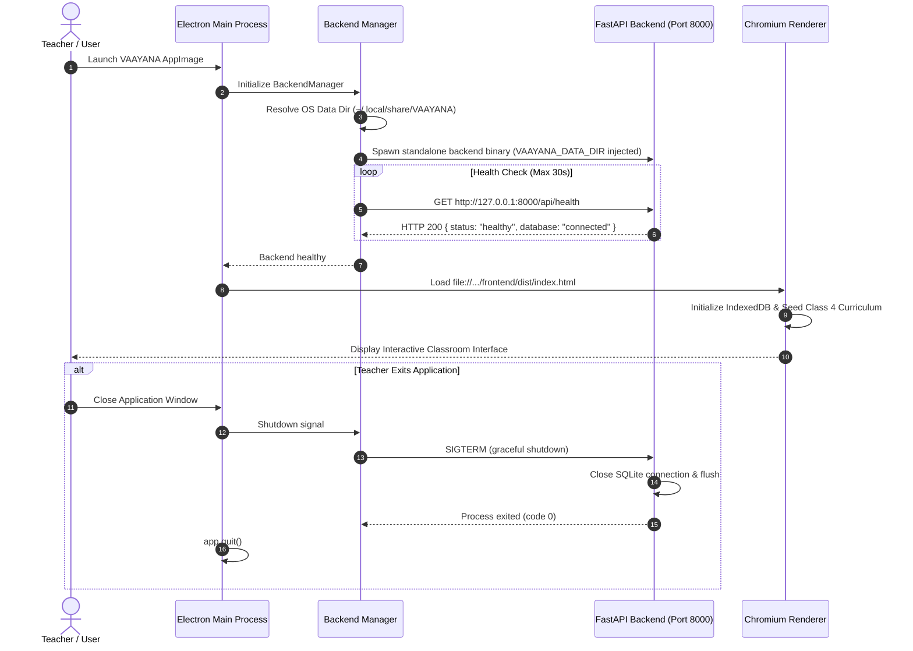

# VAAYANA (വായന) — System Architecture

This document describes the architectural design, process lifecycle, data flow, and IPC mechanisms of the VAAYANA smart classroom application.

---

## 1. High-Level Architecture

VAAYANA uses a **local-first, multi-process desktop architecture** combining an Electron presentation container with a local Python FastAPI microservice. The application operates entirely offline for classroom teaching while offering optional AI-assisted lesson generation during teacher preparation.

```mermaid
flowchart TD
    subgraph Host["Host OS (Ubuntu / Linux / Windows)"]
        subgraph Storage["Persistent User Storage"]
            DB[("SQLite Database\nvaayana.db")]
            UPLOADS["Uploaded Textbooks\n& Extracted Images"]
            IDB[("Chromium IndexedDB\ndrishti_educational_db")]
        end

        subgraph Desktop["VAAYANA Packaged Application"]
            subgraph ElectronMain["Electron Main Process (Node.js)"]
                MAIN["main.cjs\nWindow Management"]
                B_MGR["backend-manager.cjs\nProcess Lifecycle & Health"]
                U_MGR["updater-manager.cjs\nAuto-Updater Engine"]
            end

            subgraph Renderer["Chromium Renderer (Frontend)"]
                UI["React 18 + TypeScript\nTailwind CSS + Framer Motion"]
                NAV["Navbar & Status Monitors"]
                CLASSROOM["Classroom View\n(Interactive Manipulatives)"]
                TEACHER["Teacher Workspace\n(Lesson Authoring & Review)"]
                PRELOAD["preload.cjs\nIsolated IPC Bridge"]
            end

            subgraph Backend["Bundled FastAPI Backend (Python)"]
                API["main.py\nFastAPI Application (Port 8000)"]
                DOC["ocr.py\nPyMuPDF Extraction & Tesseract OCR"]
                AI["gemini_service.py\nGemini 2.5 Flash Engine"]
                CACHE["database.py\nScoped Cache & SQL Layer"]
            end
        end

        subgraph External["External Services (Optional / Online Only)"]
            GEMINI["Google Gemini API\n(Lesson Authoring)"]
            GH_RELEASES["GitHub Releases\n(Update Manifests & AppImages)"]
        end
    end

    %% Interactions
    UI --> PRELOAD
    PRELOAD <==>|Context-Isolated IPC| ElectronMain
    UI ==>|HTTP REST API (127.0.0.1:8000)| API
    UI <-->|Local Cache| IDB

    B_MGR -->|Spawn / Monitor / SIGTERM| API
    U_MGR <==>|Check & Download Updates| GH_RELEASES
    
    API <-->|Read / Write| DB
    API <-->|Save / Retrieve| UPLOADS
    API -.->|Optional AI Generation| GEMINI
    API --> DOC

    %% Storage paths
    B_MGR -.->|Injects VAAYANA_DATA_DIR| Storage
```

---

## 2. Process Lifecycle & Orchestration

The application operates as two cooperative processes:



### Process Management Rules
1. **Isolated Data Path**: All persistent application state is written to the OS user data directory:
   - Linux: `~/.local/share/VAAYANA/` (`$XDG_DATA_HOME/VAAYANA`)
   - Windows: `%APPDATA%\VAAYANA\`
2. **Zero Orphaned Processes**: `BackendManager` traps `before-quit`, `will-quit`, and process exit events, ensuring the Python backend is cleanly killed via `SIGTERM` (falling back to `SIGKILL` after 3 seconds) before Electron shuts down.
3. **Health-Gated Presentation**: Electron launches the splash/loading state and verifies the backend HTTP health endpoint before serving backend-dependent routes.

---

## 3. Inter-Process Communication (IPC)

All communication between the Chromium renderer and Electron main process is strictly isolated via `contextBridge` in `electron/preload.cjs`:

| Channel | Direction | Purpose |
|---|---|---|
| `app:get-version` | Invoke (Render $\rightarrow$ Main) | Returns package version string from `package.json` |
| `app:get-info` | Invoke (Render $\rightarrow$ Main) | Returns app metadata (`name`, `version`, `platform`, `isPackaged`) |
| `backend:status` | Invoke (Render $\rightarrow$ Main) | Retrieves backend lifecycle state (`running`, `stopped`, `error`) |
| `backend:health` | Invoke (Render $\rightarrow$ Main) | Queries `/api/health` directly through Node HTTP |
| `backend:status-changed` | Send (Main $\rightarrow$ Render) | Event stream broadcasting backend state transitions |
| `updater:check` | Invoke (Render $\rightarrow$ Main) | Triggers GitHub Releases update check |
| `updater:download` | Invoke (Render $\rightarrow$ Main) | Consents to and starts downloading the new release AppImage |
| `updater:install` | Invoke (Render $\rightarrow$ Main) | Gracefully shuts down backend and restarts into the updated AppImage |
| `updater:dismiss` | Invoke (Render $\rightarrow$ Main) | Temporarily suppresses notification for a specific release version |
| `updater:status-changed` | Send (Main $\rightarrow$ Render) | Event stream broadcasting download progress (`percent`, `bytesPerSec`) |

---

## 4. Lesson Authoring & AI Pipeline

```mermaid
flowchart LR
    A["Uploaded PDF / Textbook"] --> B["PyMuPDF Parser\n(fitz)"]
    B --> C{"Scanned Image\nor Empty Text?"}
    C -- Yes --> D["Tesseract OCR\n(Malayalam + English)"]
    C -- No --> E["Extracted Text & Document Audit"]
    D --> E
    E --> F["Chapter & Section\nHeading Detection"]
    F --> G["Compute Scoped Hash\nSHA256(file + chapter + pages)"]
    G --> H{"Approved Lesson in\nLocal SQLite Cache?"}
    H -- Cache Hit --> I["Instant Load from SQLite\n(0 API Calls, 0ms)"]
    H -- Cache Miss --> J{"Gemini API Key\nConfigured & Online?"}
    J -- Available --> K["Gemini 2.5 Flash\nStructured Prompting"]
    J -- Offline / No Key --> L["Deterministic SCERT\nTemplate Fallback"]
    K --> M["Draft Lesson Model\n(Slides, Concepts, Manipulatives, Quiz)"]
    L --> M
    M --> N["Teacher Inspection & Section Editing"]
    N --> O["Teacher Approval Action"]
    O --> P[("Persist in SQLite\nstatus = 'approved'")]
    P --> Q["Classroom Presentation Ready"]
```



---

## 5. Automatic Update Architecture

VAAYANA's auto-updater uses `electron-updater` configured with the GitHub Releases provider:

1. **Manifest Polling**: On startup (after 15 seconds) and every 4 hours, Electron requests `latest-linux.yml` from `nandita-dot/vaayana`.
2. **SemVer Comparison**: If remote version is strictly greater than `app.getVersion()`, the user is notified with release notes and version diffs.
3. **User Consent**: `autoDownload` is explicitly disabled. Updates download only when the user clicks **Download Update**.
4. **Resilient Restart**: On **Restart & Install**, Electron:
   - Signals `BackendManager` to shut down the Python FastAPI server.
   - Waits for backend exit to release SQLite file handles.
   - Replaces the current AppImage file on disk and launches the new version.
   - Retains all user data in `~/.local/share/VAAYANA/`.
