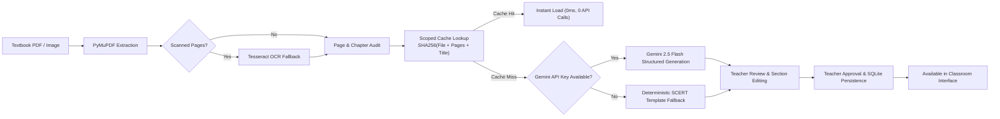

# VAAYANA (വായന)

> **Offline-first, interactive smartboard teaching platform for Kerala primary classrooms.**<br>
> *Built for smart classroom displays at A.L.P. School Koottala, Palakkad, Kerala (Class 4, Malayalam & English Medium).*

---


---

## 🌟 Overview

**VAAYANA (വായന)** is a local-first desktop application designed specifically for primary school teachers conducting lessons on interactive smartboards and digital classroom displays.

In many government primary schools, teachers face two major hurdles:
1. **Unreliable Internet**: Classrooms cannot depend on cloud-only platforms for daily teaching.
2. **Static Materials**: Digital textbooks (PDFs) are flat and non-interactive, making tactile subjects like geometry, arithmetic, and environmental science difficult to demonstrate engagingly.

VAAYANA solves this by combining **interactive digital manipulatives** (geoboards, 3D solids, rotatable clocks, virtual abacuses, and science simulators) with an **offline-ready presentation engine**. Teachers can present pre-bundled Kerala SCERT curriculum lessons with zero internet access, or prepare new interactive lessons using an evidence-grounded AI assistant powered by Google Gemini.

---

## ✨ Key Features

- **Local-First & 100% Offline Classroom Presentation**: Once installed, every bundled lesson, interactive activity, font, and illustration runs entirely on the classroom computer with zero internet dependency.
- **Interactive Smartboard Manipulatives**: Large, touch-friendly digital tools designed specifically for shared classroom displays and primary-grade children.
- **Kerala SCERT Curriculum Ready**: Pre-seeded with complete, teacher-verified Grade 4 Mathematics, Environmental Studies (EVS), and English chapters.
- **Bilingual Interface**: Native Malayalam typography (locally bundled Noto Sans Malayalam) with seamless toggling between Malayalam and English.
- **AI-Assisted Lesson Preparation**: Teachers can upload textbook PDFs; VAAYANA extracts the content using PyMuPDF and OCR, structures concepts with Google Gemini 2.5 Flash, and creates interactive slides and quizzes.
- **Deterministic Offline Fallback**: If internet or Gemini credentials are unavailable, teachers can author lessons using structured offline templates.
- **Seamless Desktop Experience**: Packaged as a standalone **Linux AppImage** with an embedded Python FastAPI backend and an integrated **GitHub Release auto-updater**.
- **Zero Data Loss Guarantee**: All teacher lessons, uploads, and database records persist in the operating system's user data directory (`~/.local/share/VAAYANA`), remaining completely safe across application updates.

---

## 📸 Application Preview

| Classroom Experience & Subject Hub | Interactive Lesson Presentation Mode |
|:---:|:---:|
|  |  |
| *Browse interactive manipulatives and curriculum chapters* | *Engaging, touch-first slide presentations and simulations* |

---

## 📚 Curriculum Scope (Class 4)

VAAYANA includes ready-to-teach, interactive learning modules aligned with the Kerala State (SCERT) Class 4 curriculum:

### 📐 Mathematics (Complete Chapters 1 – 6)

| Chapter | Title | Interactive Manipulatives & Activities |
|---|---|---|
| **Chapter 1** | **Lines and Shapes** *(വരകളും രൂപങ്ങളും)* | • **Digital Geoboard**: 5×5 interactive peg grid with stretchable colored elastic bands.<br>• **3D Shape Viewer**: Rotatable solid models (Cube, Cuboid, Cone) with faces/edges inspection.<br>• **7-Piece Tangram**: Drag-and-drop geometric silhouette puzzle. |
| **Chapter 2** | **Find the Relation** *(ബന്ധം കണ്ടെത്താം)* | • **Interactive Abacus**: 4-column place-value bead simulator.<br>• **Toto Car Race**: Real-time score counter and number-pair matching. |
| **Chapter 3** | **How Many Numbers?** *(എത്രയെത്ര സംഖ്യകൾ)* | • **Rotating Number Wheel**: Interactive place-value digit builder.<br>• **Roman Numerals Explorer**: Rules and visual converter for $I, V, X, L, C$.<br>• **Synchronized Clock**: Analogue and digital time-reading simulator. |
| **Chapter 4** | **Increasing Numbers** *(കൂടുന്ന സംഖ്യകൾ)* | • **Ways to Add Visualizer**: Multi-strategy addition decomposition and visual grouping.<br>• **Dwani Door Challenge**: Complements to 1000 puzzle game. |
| **Chapter 5** | **It's Time!** *(സമയമായി!)* | • **The Girls' Race**: Animated runner challenge with multi-clock finish-time calculations.<br>• **Water Leak Simulation**: Interactive conservation timer (1 mL/second leak rate).<br>• **Calendar Mathematics**: Dynamic monthly calendar explorer with leap-year logic. |
| **Chapter 6** | **Decreasing Numbers** *(കുറയുന്ന സംഖ്യകൾ)* | • **Abacus Subtraction**: Step-by-step place-value bead removal with animated regrouping.<br>• **Written Subtraction Board**: Vertical column-by-column interactive subtraction.<br>• **Indian Currency Explorer**: Interactive currency notes and coins calculator. |

### 🌿 Environmental Studies (EVS) & English

| Subject | Chapter | Interactive Learning Modules |
|---|---|---|
| **EVS** | **Around Us in Different Forms**<br>*(നമുക്ക് ചുറ്റും പല രൂപങ്ങളിൽ)* | Solid/Liquid/Gas item classifier, liquid container shape adaptation explorer, thermal state transitions (Melting, Evaporation, Condensation, Freezing), and air volume demonstration. |
| **EVS** | **Marvels of the Sky**<br>*(ആകാശത്തിലെ വിസ്മയങ്ങൾ)* | 3D Solar System explorer, Earth rotation & revolution simulation, animated Moon phases visualizer, and Chandrayaan lunar mission viewer. |
| **EVS** | **Directions and Homeland**<br>*(ദിക്കറിയാം നാട്ടിലൂടാകാം)* | 8-point interactive directional compass, village map navigation, magnetic compass demonstrator, and Kerala rivers & backwaters explorer. |
| **English** | **The Seed of Truth** | Interactive storybook reading, vocabulary builder, moral reflection slides, and multiple-choice reading comprehension challenges. |

---

## 🚀 Installation & Quick Start for Teachers

Primary school teachers do **not** need to install Python, Node.js, Git, or open a terminal.

### Running on Ubuntu / Linux Smartboards

1. **Download**: Get the latest `VAAYANA-*-linux-x64.AppImage` from [GitHub Releases](https://github.com/nandita-dot/vaayana/releases).
2. **Make Executable**:
   - *Using File Manager*: Right-click the `.AppImage` file $\rightarrow$ **Properties** $\rightarrow$ **Permissions** $\rightarrow$ Check **"Allow executing file as program"**.
   - *Or using Terminal*:
     ```bash
     chmod +x VAAYANA-*-linux-x64.AppImage
     ```
3. **Launch**:
   - Double-click the `.AppImage` file to run, or execute:
     ```bash
     ./VAAYANA-*-linux-x64.AppImage
     ```

> [!NOTE]
> **FUSE Dependency on Ubuntu 22.04 / 24.04**:
> If double-clicking does not launch the app, ensure FUSE is installed on your Linux system:
> ```bash
> sudo apt update && sudo apt install libfuse2
> ```
> Alternatively, launch with: `./VAAYANA-*-linux-x64.AppImage --appimage-extract-and-run`

### Automatic Updates
VAAYANA checks GitHub Releases in the background. When an update is published:
1. A discreet banner appears: *"A new version of VAAYANA is available"*.
2. Click **Download Update** to download in the background.
3. Click **Restart VAAYANA** to apply the update.
**All existing lessons, uploaded textbooks, and database records are 100% preserved.**

---

## 🏗️ Architecture & Technology Stack

VAAYANA is built with a decoupled client-server architecture packaged inside an Electron shell:

```mermaid
flowchart TD
    subgraph DesktopApp["VAAYANA Packaged Desktop App (Linux AppImage)"]
        subgraph Electron["Electron Host (Node.js)"]
            MAIN["main.cjs (Window Management)"]
            BM["backend-manager.cjs (Process Lifecycle)"]
            UM["updater-manager.cjs (Auto-Updater Engine)"]
        end

        subgraph Frontend["Chromium Renderer"]
            REACT["React 18 + TypeScript + Vite"]
            TAILWIND["Tailwind CSS + Framer Motion"]
            IDB[("IndexedDB Local Store")]
        end

        subgraph Backend["Bundled FastAPI Backend (Python)"]
            API["FastAPI REST Endpoints (Port 8000)"]
            PDF["PyMuPDF (fitz) + Tesseract OCR"]
            AI["Gemini 2.5 Flash Engine"]
            SQL["SQLite Cache Layer"]
        end
    end

    subgraph OS["Operating System"]
        DATA[("~/.local/share/VAAYANA/\n(vaayana.db & Uploaded Assets)")]
    end

    subgraph External["Online Only (Optional)"]
        GEMINI_API["Google Gemini API"]
        GH_API["GitHub Releases"]
    end

    REACT <==>|Isolated Preload IPC| Electron
    REACT ==>|HTTP REST (127.0.0.1:8000)| API
    REACT <--> IDB

    BM -->|Spawns & Monitors| API
    BM -.->|Injects VAAYANA_DATA_DIR| DATA
    API <--> DATA
    API -.->|Lesson Generation| GEMINI_API
    UM <==>|Polls & Downloads Releases| GH_API
```

### Technology Breakdown

| Layer | Technologies | Role |
|---|---|---|
| **Frontend** | React 18, TypeScript, Vite | Component-driven UI, state management, and touch interactions |
| **Styling & Motion** | Tailwind CSS, Framer Motion, Lucide Icons | Responsive layout, dark theme (`#09080F`), smartboard touch targets, fluid animations |
| **Audio & Canvas** | Web Audio API, HTML5 Canvas | Procedural celebratory chimes, sound controls, and interactive geoboard rendering |
| **Desktop Shell** | Electron 34, Electron Builder | Native windowing, lifecycle orchestration, and cross-platform AppImage packaging |
| **Backend Engine** | Python 3.10+, FastAPI, Uvicorn, PyInstaller | Local REST server compiled into a standalone binary requiring zero host Python |
| **Document Processing**| PyMuPDF (`fitz`), Tesseract OCR | Native PDF text extraction, heading detection, and OCR fallback for scanned pages |
| **AI Integration** | Google Gemini 2.5 Flash (`google-genai`) | Evidence-grounded lesson structuring, concept synthesis, and quiz generation |
| **Local Storage** | SQLite 3, IndexedDB | Scoped document caching, teacher-approved lesson persistence, and browser caching |

For in-depth architectural details and IPC specifications, see [ARCHITECTURE.md](ARCHITECTURE.md).

---

## 📖 Teacher Lesson Preparation & AI Pipeline



1. **Document Upload**: Teachers can upload textbook chapters in PDF or image format.
2. **Text & Chapter Discovery**: PyMuPDF extracts text, detected headings, and page boundaries. If text density is low, Tesseract OCR is invoked automatically for Malayalam and English.
3. **Smart Caching**: Every document chapter receives a unique SHA-256 hash. If an approved lesson already exists for that exact page range, it loads instantly from SQLite with **zero API calls**.
4. **Structured AI Generation**: Gemini 2.5 Flash transforms raw textbook content into bilingual learning objectives, core concepts, everyday examples, activity suggestions, and quizzes.
5. **Teacher Approval**: The teacher has full editorial control to modify slides, regenerate individual sections, or create activities before approving the lesson for classroom display.

---

## 🛠️ Developer Setup & Build Instructions

For full instructions, consult [DEVELOPMENT.md](DEVELOPMENT.md).

### 1. Prerequisites
- **Node.js**: `>= 20.x LTS`
- **Python**: `3.10` or `3.11`
- **Git**

### 2. Clone & Install Dependencies
```bash
git clone https://github.com/nandita-dot/vaayana.git
cd vaayana

# Install root & Electron dependencies
npm install

# Install frontend dependencies
npm --prefix frontend install

# Set up Python virtual environment
python -m venv backend/venv
# Linux/macOS:
source backend/venv/bin/activate
# Windows PowerShell:
.\backend\venv\Scripts\Activate.ps1

pip install -r backend/requirements.txt
pip install pyinstaller
```

### 3. Run Locally in Development Mode
```bash
# Terminal 1: Run FastAPI backend
python backend/run_server.py

# Terminal 2: Run Vite frontend
npm run frontend:dev

# Terminal 3: Run Electron desktop shell
npm run desktop:dev
```

### 4. Build Packaged Linux AppImage
```bash
# Compiles React frontend, builds standalone Python backend, and packages AppImage:
npm run desktop:package:linux
```
Output binary: `dist-electron/VAAYANA-2.1.1-linux-x64.AppImage`

---

## 📂 Project Directory Structure

```text
vaayana/
├── .github/
│   └── workflows/
│       ├── build-ubuntu-appimage.yml # CI workflow for testing Linux packaging
│       └── release.yml               # Automated GitHub Releases publishing workflow
├── backend/
│   ├── app/
│   │   ├── config.py                 # Environment and Tesseract path resolution
│   │   ├── database.py               # SQLite schema, caching, and persistence layer
│   │   ├── gemini_service.py         # Google Gemini 2.5 Flash prompt orchestration
│   │   ├── models.py                 # Pydantic schemas for lessons and responses
│   │   └── ocr.py                    # PyMuPDF extraction and Tesseract OCR pipeline
│   ├── build_backend.py              # PyInstaller compilation script
│   ├── main.py                       # FastAPI application entry point and endpoints
│   ├── requirements.txt              # Python backend dependencies
│   └── run_server.py                 # Development backend server launcher
├── docs/
│   ├── ARCHITECTURE.md               # Detailed system architecture and IPC guide
│   ├── DEVELOPMENT.md                # Developer onboarding and build instructions
│   └── learning-guide/               # Educational walkthrough modules
├── electron/
│   ├── backend-manager.cjs           # Cross-platform Python process orchestrator
│   ├── icons/                        # Application icons (PNG, ICO)
│   ├── main.cjs                      # Electron main entry point & window manager
│   ├── preload.cjs                   # Secure, context-isolated IPC bridge
│   └── updater-manager.cjs           # GitHub Releases auto-updater manager
├── frontend/
│   ├── public/fonts/                 # Locally bundled Noto Sans Malayalam fonts
│   ├── src/
│   │   ├── components/               # Navbar, footer, audio controls, updates
│   │   │   └── activities/           # 20+ Interactive smartboard learning manipulatives
│   │   ├── data/                     # SCERT Class 4 lessons (Math, EVS, English)
│   │   ├── pages/                    # Landing, Classroom, Teacher Workspace, Library
│   │   ├── services/                 # IndexedDB storage and backend REST client
│   │   └── App.tsx                   # Root router and layout container
│   ├── package.json                  # Frontend dependencies and Vite configuration
│   └── vite.config.ts                # Vite build configuration (relative asset base)
├── package.json                      # Root configuration and electron-builder spec
├── PROJECT_DOCUMENTATION.md          # Comprehensive product documentation
└── README.md                         # Project overview and user manual
```

---

## 🔒 Privacy & Data Retention

- **Zero Telemetry**: VAAYANA contains no tracking pixels, analytics hooks, or third-party user monitoring.
- **No Student Accounts**: The application is teacher-driven; no student personal data is ever collected or stored.
- **Local Persistence**: All created lessons, database records, and uploaded textbook files reside strictly on the local filesystem (`~/.local/share/VAAYANA/`).
- **Secure Credentials**: If an optional Google Gemini API key is configured, it is stored in a local `.env` file or environment variable and is never exposed to the client or committed to Git.

---

## 🗺️ Implementation Roadmap

### ✅ Completed & Tested
- [x] Full Class 4 Mathematics curriculum (Chapters 1 through 6) with 15+ tactile manipulatives.
- [x] Class 4 Environmental Studies (EVS) modules (Matter, Space & Moon, Directions & Geography).
- [x] Class 4 English module (*The Seed of Truth*).
- [x] PyMuPDF digital text extraction with Tesseract OCR fallback for scanned Malayalam textbooks.
- [x] AI lesson structuring with Google Gemini 2.5 Flash and offline SCERT template fallback.
- [x] Local-first SQLite persistent caching and Chromium IndexedDB storage.
- [x] Standalone Linux x64 AppImage packaging with bundled Python backend.
- [x] GitHub Releases publishing automation and non-blocking in-app auto-updater.

### 🔮 Planned Enhancements
- [ ] Student self-practice mode with audio instructions in Malayalam.
- [ ] Teacher voice note recording for custom slide explanations.
- [ ] Additional Class 4 chapters (Language, Malayalam Reader, Social Science).
- [ ] Cross-platform Windows installer (`.exe` NSIS package) for schools running Windows PCs.

---

## 🏫 Context & Acknowledgments

VAAYANA was designed and developed for **ALP School Koottala**, Erimayur, Palakkad, Kerala, to enhance primary school smartboard classrooms with modern, interactive digital teaching aids.

- **Developer**: Nandita Nair
- **Licensing**: For institutional deployment or inquiry, refer to [LICENSE](LICENSE).
